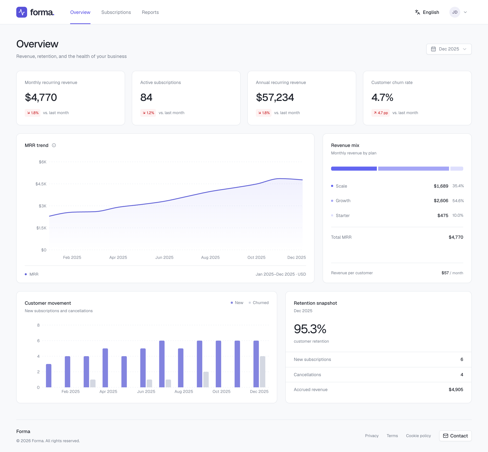
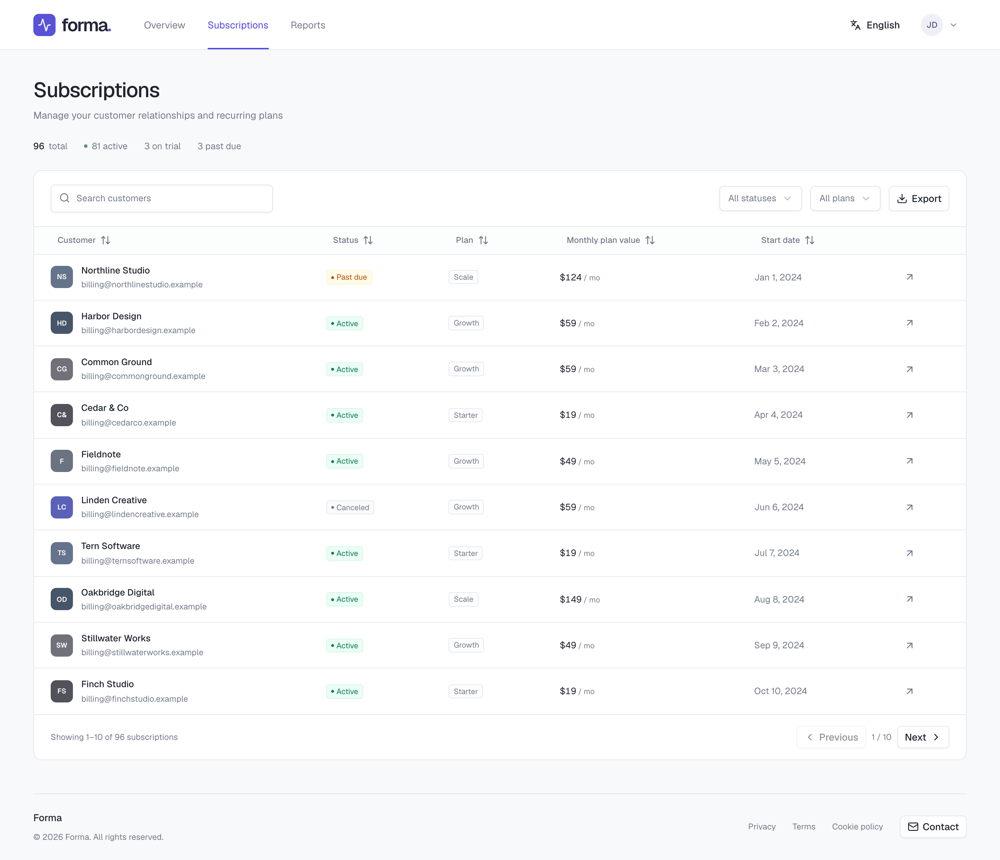
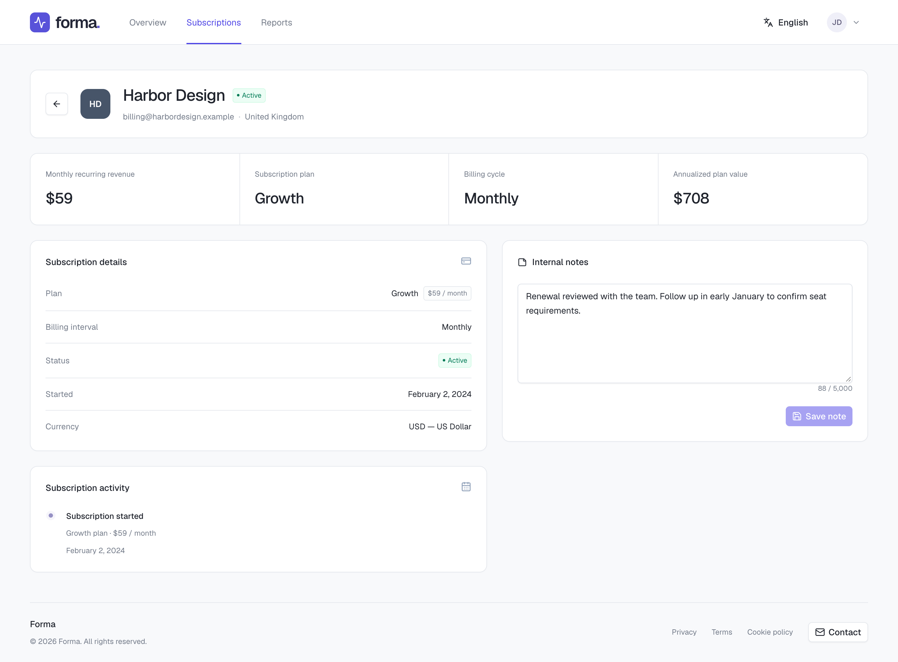
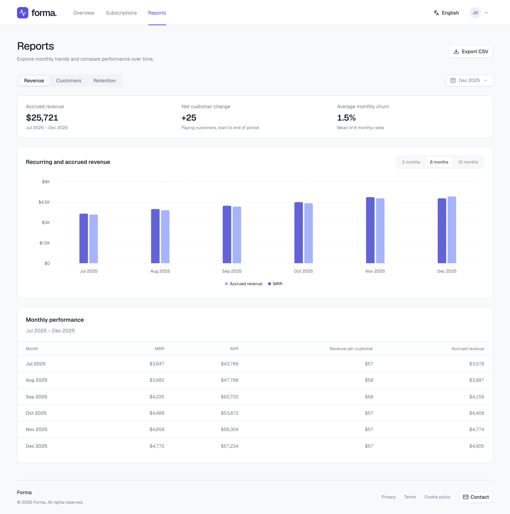
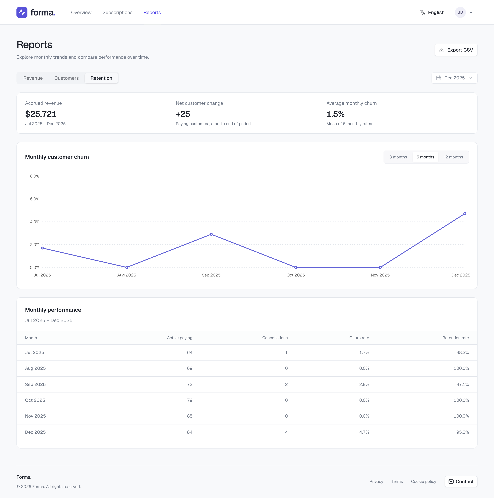
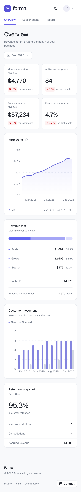

# Forma

Subscription analytics with a clear path from a revenue headline to the customer records behind it.

 

## Read the business at three levels

**Overview** brings monthly recurring revenue, customer movement and plan mix into one view. Chart tooltips and reporting periods make the numbers easy to inspect.

**Subscriptions** gives the analysis a customer-level view: search, filter, sort and open a record, then keep account context in its notes.

**Reports** separates revenue, customers and retention. Each view combines charts with supporting tables and CSV export, so a useful result can leave the dashboard.

- Shared calculations across overview, subscription details and reports.
- Searchable subscription directory with sorting, filters and pagination.
- Customer notes and saved reporting preferences.
- Revenue, customer and retention reports with CSV export.
- English, German and Spanish interfaces, including localized dates and numbers.

## A closer look

Subscription directory and customer details

Revenue and retention reports

Mobile overview

## Stack

Next.js 16, React 19, TypeScript, shadcn/ui, Tailwind CSS, Recharts and TanStack Table.

## Demo

[Open the interactive demo](https://forma-demo-brazhdev.pages.dev/). Choose a demo account on the sign-in screen.
